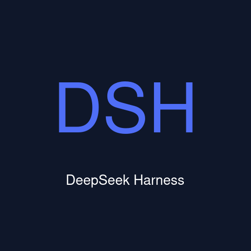
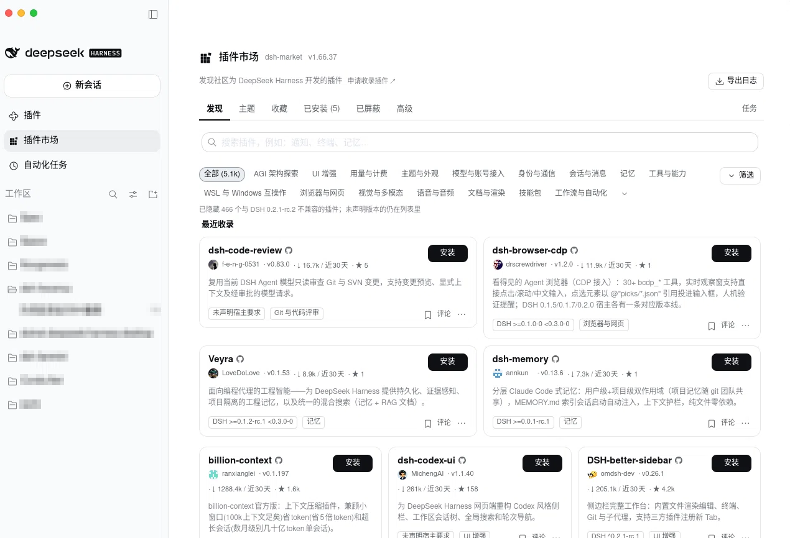

<p align="center">
  
</p>

# DeepSeek Harness Desktop for .NET

<p align="center"><a href="README.en.md">English</a> · <strong>中文</strong></p>

<p align="center"><strong>DeepSeek Harness 的 .NET 桌面壳——交互与模型都在全局 dsh 里，壳只管窗口、监督与更新。</strong></p>

<p align="center">
  <a href="#功能">功能</a> ·
  <a href="#下载安装">下载安装</a> ·
  <a href="docs/user-guide.md">用户指南</a> ·
  <a href="docs/faq.md">常见问题</a> ·
  <a href="#工作原理">工作原理</a> ·
  <a href="#开发">开发</a> ·
  <a href="#文档">文档</a> ·
  <a href="LICENSE">MIT License</a>
</p>

<p align="center">
  <a href="https://github.com/ZK-Andy/dotnet-deepseek-harness-desktop/releases"></a>
  <a href="https://github.com/ZK-Andy/dotnet-deepseek-harness-desktop/releases"></a>
  <a href="https://github.com/ZK-Andy/dotnet-deepseek-harness-desktop"></a>
  <a href="LICENSE"></a>
  <a href="https://github.com/ZK-Andy/dotnet-deepseek-harness-desktop/actions/workflows/ci.yml"></a>
  <a href="https://github.com/ZK-Andy/dotnet-deepseek-harness-desktop/actions/workflows/ci.yml"></a>
  <a href="docs/testing.md"></a>
  <a href="https://github.com/ZK-Andy/dotnet-deepseek-harness-desktop/releases"></a>
  <a href="https://dotnet.microsoft.com/download/dotnet/10.0"></a>
</p>

[DeepSeek Harness](https://github.com/deepseek-ai/deepseek-harness)（MIT）的 .NET 桌面客户端，基于 [Ryn](https://github.com/Yupmoh/Ryn)（Tauri-for-C# 的原生 WebView 框架）。壳不自带运行时：node 与 dsh 都用系统全局的那一份（`npm install -g @deepseek-ai/dsh@next`），桌面与终端共享同一数据目录，会话、凭据、插件天然互通。首次启动检测 PATH 上的全局 dsh——没有就装；探测到的版本低于兼容底线就走引导更新到 `@next`；达标直接用（判据是兼容底线，不逐次查 npm dist-tag）。

<p align="center">
  <a href="assets/screenshot.png"></a>
</p>

<p align="center"><sub>插件市场（<code>dshmarket</code>，由你在 dsh 内自行安装；图为已装 5 个插件的市场页）</sub></p>

## 为什么是壳

- **不带运行时** — 安装包只含壳（约 30MB 级），不为桌面再发一份运行时闭包；node 走系统全局，没有私有 PATH。
- **不钉版本** — dsh 跟随 `@next` 正式版通道，上游发版即生效，不必等桌面发版。
- **同一数据目录** — `~/.dsh` 与 CLI/TUI/Web 共享会话、凭据、工作区；桌面插件只占 `profiles/dotnet-desktop`。
- **不冒充宿主** — 跑在系统 WebView 里，页面与插件行为同浏览器侧一致，dsh 插件不受影响。
- **不代装市场** — `dshmarket` 由你在 dsh 内自行安装（`1200+` 插件可搜一键装），registry 形态与自装等价，插件更新同样不必等桌面发版。

## 功能

**外壳与运行时**

- ⚡️ **online-first 首启** — 缺则经全局 node 装；探测到的版本低于兼容底线就走引导更新到 `@next`；达标直接用；node 检查只在需要确保 dsh 时做一次，不重复联网。
- ⌨️ **CLI shim** — 幂等注册内容恒定的 `pnpm` shim 进用户 PATH（从不覆盖同名命令）；dsh 本身已在 PATH 上，终端直接可用。
- 🔒 **原生轻量** — C# 后端 + 系统 WebView（WebView2 / WKWebView / WebKitGTK），发布形态为 JIT（NativeAOT 未启用），能力沙箱 deny-by-default（`ryn.json`）。

**窗口与系统集成**

- 🪟 **无边框窗口** — 三端去掉原生标题栏由壳自绘：红绿灯在左上、侧栏顶部由自身背景无缝让位、折叠按钮同行、顶区可拖拽、双击缩放。
- 🖥️ **系统托盘** — 关窗默认最小化到托盘（可在设置改为直接退出）；菜单含显示主窗 / 检查更新 / 重启 / 退出，随 dsh 语言中英切换；退出与重启走同一套有序编排，运行时子进程干净回收。
- 🪟 **窗口状态记忆** — 重启恢复上次尺寸与最大化状态；托盘隐藏/唤回期间本就保留。
- 🚀 **单实例仲裁** — 应用运行中再次点击启动器，唤起既有主窗而非新实例（`Linux` / `macOS` 生效；`Windows` 不启用互斥，二启照常拉起新实例）。
- 🔁 **开机自启** — 设置页一键开关（Linux XDG autostart / Windows 注册表 Run / macOS LaunchAgents）。
- 🖼️ **图标与 Wayland** — 图标随包入 `hicolor`，`identifier` 与 `StartupWMClass` 同值，任务栏正确关联。

**运行时自愈与更新**

- 🔄 **崩溃自愈、回到原会话** — 崩溃 → 失败面（连续崩溃达阈值（默认 3 次）才弹；原生对话框优先：原因、stderr 尾部、自动导出诊断、继续或退出）→ 自动重启 → 同一窗口回到新 URL；**端口保持稳定**，Web UI origin 与页面级会话记忆存活。
- 🧩 **续任者收养** — 插件更新后的自重启由壳直接收养续任者：单进程、单导航，没有注定失败的竞争启动与数十秒恢复屏。
- 💓 **页面健康监护** — 只读探针识别「进程在跑但页面空白」，预算内触发一次有界 reload 自愈，耗尽转观测、恢复即复位——不注入脚本，不依赖伴生插件存活。
- ⬆️ **自更新** — 启动后台检查一次 + 设置页手动检查，一键安装并自动重启（安装包 `SHA256` 强校验；`macOS` 引导手动更新），见[保持最新](#保持最新)。

> 首选端口被本应用认不出归属的程序占用时会漂移到新端口，origin 随之改变——后果与恢复方式见[常见问题](docs/faq.md)。端口漂移判据、收养血统、探针预算等机理细节以 [docs/architecture.md](docs/architecture.md) 为准。

## 下载安装

从 [Releases](https://github.com/ZK-Andy/dotnet-deepseek-harness-desktop/releases) 下载对应平台安装包（附 `SHA256SUMS.txt` 校验）：

| 平台 | 架构 | 包 | 首次打开 |
|---|---|---|---|
| `Linux` | `x64` / `arm64` | `deb`（`…_linux-amd64.deb` / `…_linux-arm64.deb`）、`rpm`（`…_linux-x86_64.rpm` / `…_linux-aarch64.rpm`） | `sudo apt install ./…deb` 或 `sudo dnf install ./…rpm`（依赖由包管理器解决） |
| `macOS` | `arm64` / `x64` | `dmg` | 拖入「应用程序」后启动；被 Gatekeeper 拦截时右键「打开」，或 系统设置 → 隐私与安全性 →「仍要打开」 |
| `Windows` | `x64` | `exe` 安装器（`…-setup.exe`） | 运行安装器；SmartScreen 提示时「更多信息」→「仍要运行」 |

> **未签名**：本项目开源、不做付费签名，发布包未签名——上表的放行步骤即为此。开发/内部可用 `SELF_SIGN=1` 消除本机告警，见 [docs/development.md](docs/development.md)。
>
> **预览版**：项目处于早期预览阶段，可能有破坏性变更（数据目录布局、配置格式、运行时组件版本），**不保证跨版本数据兼容**；升级前请备份重要会话与配置。
>
> **升级**：桌面 profile 目录为 `profiles/dotnet-desktop`——旧 `profiles/desktop` 在首次启动自动改名（插件与端口记忆保留）；终端手动操作请用 `dsh --profile dotnet-desktop`，详见 [docs/user-guide.md](docs/user-guide.md)。
>
> **真机验证**：验收至今只在 `Linux` `x64` `rpm` 上做过；`deb`、`Linux arm64`、`macOS`、`Windows` 仅经 CI 编译/打包/冒烟，`macOS x64` / `Windows` 的真机测试等待社区支持。判定边界见 [docs/testing.md](docs/testing.md)。

## 保持最新

- 启动时后台检查一次新版本（不轮询、不打扰）；也可在 **设置 → 桌面设置** 或托盘菜单手动检查（开发运行默认不装载自更新栈，此路径无动作；`DSH_DESKTOP_UPDATE_FORCE=1` 可显式装载）。
- 发现新版本后，侧栏底部出现下载按钮——点击即下载、校验、**一键安装并自动重启**（`Linux` 会弹一次系统授权）。
- 安装包落地前经 `SHA256SUMS.txt` 强校验，校验失败拒绝安装。
- `macOS` 暂不支持应用内静默更新，检测到新版本时提示手动下载 `dmg`。

## 工作原理

Ryn 壳（C# + 系统 WebView）经回环代理承载 PATH 上全局 dsh 的 Web UI：崩溃监督同端口重启、首启自动引导全局 node/dsh、随包伴生插件在 spawn 前就位。启动模型与分层见 [docs/architecture.md](docs/architecture.md)（单一事实源）。

[](docs/architecture.html)

> 交互版（主题 / 平移缩放 / 搜索 / 关系追踪 / 导出）用浏览器本地打开 [docs/architecture.html](docs/architecture.html)。

## 开发

```sh
# 前置：.NET 10 SDK；Linux 需 WebKitGTK
# 运行（开发环境必须带 DSH_DESKTOP_DEV=1——dev 隔离见 docs/development.md；无 PATH dsh 时走首启引导，需网络）
DSH_DESKTOP_DEV=1 dotnet run --project src/DeepSeek.Harness.Desktop

# 测试
dotnet test dotnet-deepseek-harness-desktop.slnx

# WebView 调试器（默认关）
DSH_DEVTOOLS=1 dotnet run --project src/DeepSeek.Harness.Desktop
```

> 运行时需要可达的 DeepSeek provider 凭据（如 `DEEPSEEK_API_KEY`）才能提供 Web UI。打包、dev 隔离与门禁清单见 [docs/development.md](docs/development.md) / [docs/testing.md](docs/testing.md)。

## 目录

```
├── src/DeepSeek.Harness.Desktop/              # Ryn 壳（Presentation）：组合根 + UI 桥
├── src/DeepSeek.Harness.Desktop.Core/         # 纯逻辑（零外层引用）
├── src/DeepSeek.Harness.Desktop.Infrastructure/  # 适配器（Ryn/native、dsh 进程、文件/网络、更新）
├── tests/                                     # xunit：壳 / Core / Infrastructure / 分析器契约
├── tools/DeepSeek.Harness.Desktop.Analyzers/  # Roslyn 自研分析器（D003 机器化）
├── scripts/                                   # 门禁 + package-*.sh + release-preflight.sh + release-notes.sh
└── docs/                                      # 架构、测试、开发、用户指南、FAQ、踩坑记录
```

## 文档

| 文档 | 内容 |
|---|---|
| [用户指南](docs/user-guide.md) | 安装、首次启动、日常使用、数据与日志位置、故障排查 |
| [常见问题](docs/faq.md) | 端口漂移、插件市场、数据互通、MCP 连接等高频疑问 |
| [架构](docs/architecture.md) | 启动模型、监督与失败面、插件装配、自更新、打包（单一事实源） |
| [测试与门禁](docs/testing.md) | CI 矩阵、真机验证边界、门禁清单 |
| [开发](docs/development.md) | 运行步骤、dev 隔离、打包与自签 |
| [踩坑记录](docs/cookbook.md) | 实机判别条目（上游现象与本地故障的区分） |

## 许可与致谢

- 本项目：MIT。
- [deepseek-harness](https://github.com/deepseek-ai/deepseek-harness)（MIT）—— 本壳托管的运行时。
- [Ryn](https://github.com/Yupmoh/Ryn)（MIT）—— 桌面壳框架。
- 打包思路参考 [pilot-harness](https://github.com/op7418/pilot-harness)。

[](https://github.com/deepseek-ai/deepseek-harness)
